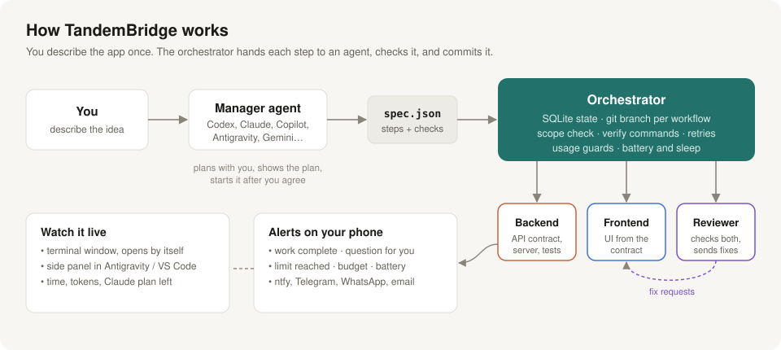
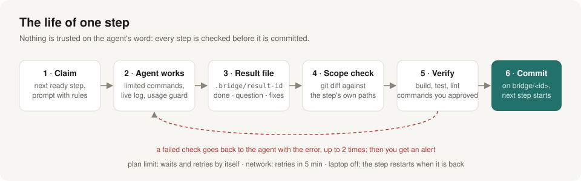
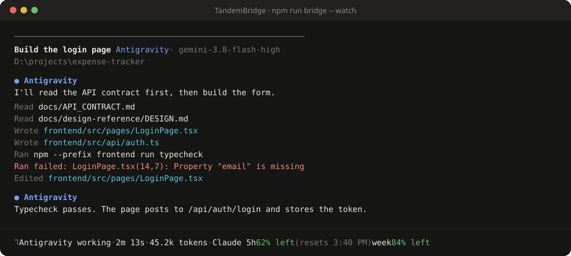

<p align="center">
  <picture>
    <source media="(prefers-color-scheme: dark)" srcset="docs/images/logo-dark.svg">
    
  </picture>
</p>

**A local orchestrator that turns one project description into a working app, built by a team of
AI coding agents you already use.**

You describe the app to your favourite agent. It plans the work with you as the **manager**. Then
the orchestrator hands each step to a builder agent: one writes the API contract and backend,
another builds the frontend from that contract, and a reviewer checks both and sends fixes back.
Every step is checked and committed to its own git branch, you can watch it live, and your phone
gets an alert when it is finished or when something needs you.

It runs on your own computer, with your own agent subscriptions. No server, no hosted service,
and nothing is pushed or deployed for you.



## Contents

- [Why](#why)
- [What you need](#what-you-need)
- [Setup](#setup)
- [Daily use](#daily-use)
- [How a project is built](#how-a-project-is-built)
- [The life of a step](#the-life-of-a-step)
- [Watching the work](#watching-the-work)
- [What keeps the agents in line](#what-keeps-the-agents-in-line)
- [Token usage](#token-usage)
- [Alerts](#alerts)
- [Commands](#commands)
- [Repository structure](#repository-structure)
- [Configuration](#configuration)
- [Backups](#backups)
- [Good to know](#good-to-know)
- [Author](#author)

## Why

One AI agent working alone on a whole app drifts: it forgets the API it wrote an hour ago, rewrites
files it should not touch, says "done" when the build is broken, and burns through a plan's limit.
TandemBridge splits the work into small steps with a clear owner, a list of files each step may
change, and commands that must pass before anything is committed. The agents talk through a shared
contract, not through memory.

## What you need

- **Windows 10 or 11** (the orchestrator uses Windows for sleep, battery, and terminal windows).
- **Node.js 22** or newer, and **git**.
- At least one agent, logged in with your own account:

  | Agent | Cost | Good at |
  |---|---|---|
  | [Claude Code](https://claude.com/claude-code) | Claude plan or API | Backend, API contracts, review |
  | Antigravity (`agy`) | Free tier | Frontend, and you can watch it in its IDE |
  | Codex | ChatGPT plan | Any job; has its own sandbox |
  | GitHub Copilot CLI | Copilot plan | Any job |
  | Gemini CLI | Free with a Google login | Any job, at no cost |

One agent can do every job. With only free tools, for example Gemini CLI or Antigravity for
everything, it still works.

## Setup

**One line, in PowerShell:**

```powershell
irm https://raw.githubusercontent.com/AhmedRaza186/TandemBridge/main/install.ps1 | iex
```

From Command Prompt (`cmd`) instead:

```cmd
powershell -ExecutionPolicy Bypass -c "irm https://raw.githubusercontent.com/AhmedRaza186/TandemBridge/main/install.ps1 | iex"
```

It asks which drive or folder to put TandemBridge in (pick from a list, browse with a folder
window, or type a path), checks for Node.js 22+ and git and offers to install them with `winget`,
downloads TandemBridge there, installs its packages, and runs its tests. At the end it lists the
IDEs and agents it finds (VS Code, Antigravity, Cursor, Claude Code, Codex, Gemini CLI, Copilot CLI)
and opens the folder in the one you pick, so you can start setup right away.

Run it again any time to update the same folder; it never touches your `.env`, profile, or data.
As with any script from the internet, [read it](install.ps1) before you run it. Set
`TANDEMBRIDGE_HOME` first to skip the folder question.

**Or by hand:**

```powershell
git clone https://github.com/AhmedRaza186/TandemBridge.git
cd TandemBridge
npm install
```

Then open your agent in that folder and ask it: **"Follow docs/SETUP.md"**. In Claude Code you can
type `/setup` instead. The setup is an interview, in your own language:

1. It checks Node and git, installs dependencies, and lists which agents are installed.
2. It asks who should do each job (manager, backend, frontend, reviewer) and installs only the
   agents you pick, after asking.
3. It asks where you want alerts: phone push (ntfy), Telegram, WhatsApp, or email.
4. It asks how much of your plan a project may use, and what the manager may decide alone.
5. It writes `bridge.profile.json`, your settings in `.env`, and the manager's `AGENTS.md`, then
   runs the tests.
6. For each password or token an alert channel needs, it gives you one command to run in your own
   terminal, for example `npm run bridge -- set-key SMTP_APP_PASSWORD`. You paste the value there,
   it shows only `*`, and it goes straight into `.env`. The agent never sees it, and you never
   edit `.env` by hand.

Nothing it writes is committed: your choices and secrets stay on your computer.

## Daily use

```powershell
# 1. Keep this running in its own terminal
npm run bridge -- run

# 2. Open your manager agent in this folder and describe what you want built.
#    It asks questions, writes the plan, shows it to you, and starts it after you agree.

# 3. Check on it any time, or just ask the manager
npm run bridge -- status
```

Without a manager agent: `npm run bridge -- plan "D:\path\to\project" "what you want built"` has
Codex write the plan, then `npm run bridge -- start "data\specs\<name>.json"` runs it. Or paste the
output of `npm run bridge -- planner-prompt` into any chat AI with your idea, save its JSON, and run
`npm run bridge -- start spec.json --workspace "D:\path\to\project"`.

## How a project is built

1. **Plan.** The manager turns your idea into a spec: a short list of steps (usually 4 to 7), each
   with an owner, the files it may change, what "done" means, and the commands that prove it.
   You see the whole plan, including every command that will run on your computer, before it starts.
2. **Rules go into the project.** Starting a workflow writes the project's rule files and commits
   them:

   | File in your project | What it sets |
   |---|---|
   | `docs/API_CONTRACT.md` | Every endpoint, written by the first step. Both sides follow it |
   | `docs/BACKEND.md` | Backend structure and security rules (OWASP, Node.js best practices) |
   | `docs/design-reference/DESIGN.md` | The visual style you chose from `references/` |
   | `docs/design-reference/CRAFT.md` | What every UI must avoid so it does not look AI-generated |
   | `AGENTS.md` (+ `CLAUDE.md`, `GEMINI.md`) | Tells every agent to read and follow the files above |

3. **Build.** The backend agent writes the contract and the server, the frontend agent builds the
   UI against the contract, and agents can ask each other questions (up to 3 per workflow).
4. **Review.** The reviewer checks both sides against the contract and the rules. Real defects go
   back as fix steps, for up to 2 rounds; after that it asks you.
5. **Done.** You get an alert with how to run the app. Everything is on the `bridge/<id>` branch of
   your project, one commit per step, ready for you to read and merge yourself.

## The life of a step



The agent ends every step by writing `.bridge/result-<id>.json` in the project. A step can finish,
ask another agent a question, ask you, or (for a review) send fixes back. The orchestrator does
not take "done" on trust: it checks the changed files with `git diff`, runs the step's `verify`
commands, and only then commits.

| Failure | What happens |
|---|---|
| Agent error, failed check, or no result file | Retried twice, with the error as feedback |
| Plan or quota limit | Waits and retries every 30 minutes, by itself |
| Network | Retries after 5 minutes |
| Laptop off or crash | The step restarts when the orchestrator does |
| Expired login | Waits for you to log in and `resume` |
| Still failing | The workflow stops and alerts you; `retry` continues it |

All state lives in SQLite, so a restart never loses work.

## Watching the work

Every step, from Claude, Antigravity, or any other agent, is shown live like a chat: what the
agent says, the files it reads and writes, the commands it runs, how long it has run, the tokens
it has used, and the result.



- **A terminal window** opens by itself when the first step starts, and follows every step after
  it. Its bottom line shows the step's time and tokens and how much of the Claude plan is left for
  the 5-hour window and the week. Open one yourself with `npm run bridge -- watch`, or
  `npm run bridge -- watch "D:\path\to\project"` for one project. Closing it does not stop the
  work. Set `WATCH_WINDOW=off` in `.env` to stop it opening.
- **A side panel in Antigravity or VS Code**, for the project open in that window. Install it once
  with `npm run bridge -- extension-install` (it installs into every IDE it finds), reload the
  window, and click the TandemBridge icon in the activity bar. Drag it to the right side bar once
  to keep it beside the chat. The IDE's own agent panel cannot show these steps, because the work
  runs through the agents' CLIs, which keep their conversations apart from the IDE.

`npm run bridge -- limits` checks the Claude plan with one tiny Haiku call. Antigravity, Codex,
and Gemini do not report what is left of their plans, so only their tokens used are shown. Live
logs are kept in `data/live/` for three days.

## What keeps the agents in line

- **Folder ownership.** Each step lists the paths it may change. Touching anything else, including
  a rename, fails the step.
- **Own branch.** Each workflow works on `bridge/<id>`. The orchestrator commits each finished step
  and never pushes, merges, or deploys.
- **Limited commands.**
  - Claude may run `npm`, `npx`, `node`, and read-only git.
  - Antigravity may run only install, build, test, lint, and typecheck for its own folders, can
    `git rm` only files its step lists by exact path, and cannot edit outside the project.
  - Codex runs in its own sandbox, which keeps writes inside the project and the temp folder.
  - Copilot and Gemini CLI may edit files and run only `npm install`, `npm ci`, `npm test`,
    `npm run`, and read-only git.

  `npm` can run any script, so treat this as a guard against accidents, not a security boundary,
  and only build projects you trust.
- **Checks you approved.** Commands in a step's `verify` list are run by the orchestrator, not the
  agent. A failure goes back to the agent up to 2 times.
- **Build rules.** Backend work follows [templates/BACKEND.md](templates/BACKEND.md): feature
  modules, validated input, safe errors, hashed passwords, rate limits, and a server bound to
  `127.0.0.1`. UI work follows the chosen style pack plus [references/CRAFT.md](references/CRAFT.md).
  The reviewer reports broken rules as defects. Edit `docs/BACKEND.md` inside a project to change
  its rules, or set `TANDEMBRIDGE_BACKEND_GUIDE` to change them for every new project.
- **Limits on talk.** 2 review rounds and 3 agent-to-agent questions per workflow, then it asks you.

## Token usage

Every step spends tokens from your own plans. TandemBridge keeps that in check:

| Level | Guard per step / workflow | For |
|---|---|---|
| `saver` | $3 / $15 | Claude Pro, or keeping the plan for other work |
| `balanced` (default) | $6 / $30 | Claude Max 5x, most people |
| `max` | $12 / $60 | Claude Max 20x or the API, the hardest projects |

- Set the level in `bridge.profile.json`: `"limits": { "usage": "saver" }`. Every Claude step runs
  on Opus 5.5 at medium effort; the level sets how much a step and a workflow may use.
- Each workflow alerts you at 80% of its guard and pauses at 100%. On a Pro or Max plan the guards
  are usage at API prices, not a bill, but they stop one project from using up the whole plan.
- When a plan's own limit runs out, the step pauses and retries by itself later instead of failing.
- Agents are told to search before reading, read only what their step needs, and run narrow tests.
  Claude cannot read `node_modules`, lockfiles, or build output at all.

`CLAUDE_MODEL` or `CLAUDE_EFFORT` in `.env` forces one model or effort for every Claude step.

## Alerts

You get an alert when work is complete, when an agent has a question only you can answer, when a
limit or the budget is reached, when the battery is low, and when the laptop comes back after being
off. Alerts arrive in the language you chose during setup, on every channel you turn on:

| Channel | Cost | Notes |
|---|---|---|
| ntfy | Free | Phone push through the ntfy app, no account. `npm run bridge -- ntfy-topic` makes a private topic |
| Telegram | Free | Create a bot with @BotFather, then `npm run bridge -- telegram-chat-id`. Blocked in some countries |
| Email | Free | Gmail with an [App Password](https://myaccount.google.com/apppasswords) |
| WhatsApp via CallMeBot | Free | Your own number only; an unofficial third-party service |
| WhatsApp Cloud API | Paid by Meta | Needs a Meta app, a number, and an approved template |

Secrets go in with `npm run bridge -- set-key <NAME>`, typed hidden in your own terminal;
`npm run bridge -- keys` shows which settings are filled in, without showing any value.
`npm run bridge -- notify-test` sends a test to every channel that is on.

| Alert says | What to do |
|---|---|
| Work complete | Run the app, using the steps in the alert |
| Your answer needed | `npm run bridge -- answer <id> "text"` |
| Stopped (limit) | Nothing: it retries by itself |
| Stopped (login) | Log in, then `npm run bridge -- resume <workflow>` |
| Budget limit | `npm run bridge -- resume <workflow> --budget 10` |
| Battery low / URGENT | Plug in the charger (at 10% no new steps start) |
| System was offline | Nothing: work has already resumed |
| Work stopped | Read the error, then `npm run bridge -- retry <workflow>` |

## Commands

All commands are `npm run bridge -- <command>`:

| Command | What it does |
|---|---|
| `run` | Start the orchestrator (keep this terminal open) |
| `status [workflow]` | Every workflow, its steps, usage, and anything waiting for you |
| `watch [workspace]` | Follow the running step live in this terminal |
| `limits` | How much of the Claude plan is left (one tiny Haiku call) |
| `set-key <NAME> [value]` | Put a setting in `.env`. A secret is typed hidden, in your own terminal |
| `keys` | Which settings in `.env` have a value (never shows the values) |
| `plan <workspace> "<idea>"` | Codex writes a spec into `data/specs/` |
| `start <spec.json> [--workspace D] [--reference name]` | Start a workflow from a spec |
| `answer <task id> "<text>"` | Answer a step that is waiting for you |
| `resume <workflow> [--budget N]` | Continue a paused workflow |
| `retry <workflow> ["<note>"]` | Run a failed workflow's failed steps again, keeping their files |
| `cancel <workflow>` | Stop a workflow; files and commits stay on its branch |
| `references` / `reference-add <name> <screenshots>` | List UI style packs, or add a site you like |
| `agents` / `agent-install <agent>` | Which agents are installed, and install one |
| `extension-install` | Install the live side panel into Antigravity and VS Code |
| `notify-test`, `ntfy-topic`, `telegram-chat-id` | Set up and test alerts |
| `backup` | Copy the database to `BACKUP_DIR` now |
| `messages` | Print every alert in English, for translating |
| `planner-prompt` | The planning rules, to paste into any chat AI |

## Repository structure

```text
TandemBridge/
├── install.ps1                one-line installer for Windows
├── bin/tandembridge.js        command line entry point
├── src/
│   ├── cli/                   the bridge commands
│   ├── core/                  scheduler, workflows, git guards, style packs, battery and sleep
│   ├── agents/                how each agent CLI runs, live logs, watch, the planner
│   ├── notifications/         alert outbox (email, ntfy, Telegram, WhatsApp) and alert text
│   ├── config/                settings, profile, usage levels
│   └── db/                    SQLite connection, migrations, backups
├── extensions/antigravity/    IDE side panel for Antigravity and VS Code
├── references/                UI style packs, and CRAFT.md (no generic AI look)
├── templates/                 AGENTS.md and BACKEND.md given to every project
├── schemas/                   JSON schema of a workflow spec
├── docs/                      SETUP.md (the setup interview), architecture.md, images
├── test/                      test suite (node --test)
└── data/                      database, logs, live logs, specs. Never committed
```

See [docs/architecture.md](docs/architecture.md) for more on the code, and
[references/README.md](references/README.md) for the UI style packs.

## Configuration

| File | Purpose | Committed |
|---|---|---|
| `.env` | Alert settings and secrets (see [.env.example](.env.example)). Filled in with `set-key` | No |
| `bridge.profile.json` | Team roles, usage level, alert language and translations | No |
| `AGENTS.md` | The manager's instructions, generated from `templates/` | No |

`TANDEMBRIDGE_DB`, `TANDEMBRIDGE_LOG`, and `TANDEMBRIDGE_PID` move the files in `data/`.

## Backups

Optional. Set `BACKUP_DIR` in `.env` to a folder, ideally one synced by OneDrive or Google Drive.
The orchestrator copies its database there every 6 hours (`BACKUP_EVERY_HOURS`) and keeps the
newest 14 (`BACKUP_KEEP`). `npm run bridge -- backup` takes a copy now. To restore, stop the
orchestrator and copy a backup over `data/bridge.db`.

## Good to know

- The laptop must stay on and awake. The orchestrator asks Windows not to sleep during a run, but
  closing the lid follows your Windows lid setting.
- Agents run one at a time.
- Usage figures are guards. On a Pro or Max login they are notional, not a bill.
- Tests: `npm test`.

## Author

Built by **Ahmed Raza** ([@AhmedRaza186](https://github.com/AhmedRaza186)).

Released under the [MIT License](LICENSE).
